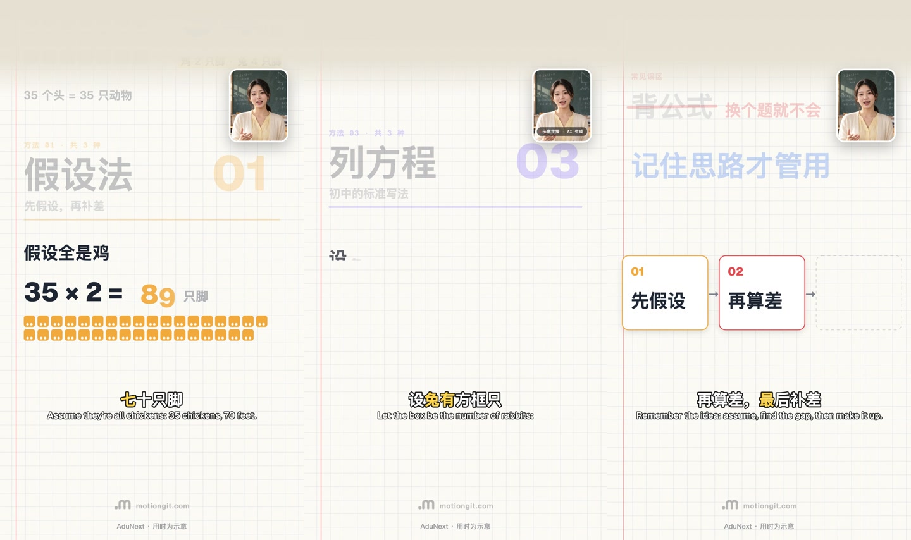

# 教育 · 三种解法

假设法 · 抬脚法 · 列方程。行业竖屏口播预上线 Demo，欢迎提出建议。

**9:16 · 1080 × 1920 · 60 fps · v1.0.5** · [@adunext](https://motiongit.com/@adunext) · [English](README.md)

Motion 模板现已接入背景音乐、贴纸、图片和视频等素材接口，并提供免费背景音乐及免费素材检索。升级版模板仍然 **100% 免费开源**。请从下方 MotionGit 官网下载升级版，官网按账号提供接口访问，防止批量请求滥用。素材接口的免费范围以官网说明为准。

**[官网下载 .motion](https://motiongit.com/@adunext/industry-education-three-solutions)**
https://motiongit.com/@adunext/industry-education-three-solutions

Demo 已公开，下载开放状态以官网为准。

## Demo

[查看完整样片](https://motiongit.com/@adunext/industry-education-three-solutions) · [播放视频](https://motiongit.com/media/previews/industry-v7/05m_edu-demo-9cdf56c7553afde3.mp4)

## 技术原理

- 声明的运行配置：adudir.generator/1。
- 通过模板参数和预设，将本期文字、数据或素材映射到已有动画工程。
- 已声明时长随本期配音适配，最终节奏由包内制作计划确定，样片时长不是固定成片时长。

样片时长: **110.28s**. 已声明输出为 1080 × 1920，60 fps；公开样片 110.28 秒。 按实际包的参数边界制作；增加素材不会自动增加场景。

## 输入素材与内容

- **必需:** 原生口播流程使用的本期人物视频与原声。
- **可选:** 这次要呈现的照片与作品标题。

适用内容: 教育类账号的观点、测评和科普口播 · 按提词器录一条口播就能出片

## 运行环境

- 声明的运行配置：adudir.generator/1。具体工具与版本以下载包为准。
- 按下载包的依赖锁和 setup/check 说明检查已有工具，只补齐缺项，并验证预览。

## 使用模板

1. 从[模板页面](https://motiongit.com/@adunext/industry-education-three-solutions)获取当前版本的完整 .motion。
2. 按包内说明解压或加载，读取 README 和引用的制作指南。
3. 使用本期内容与素材，复用已有环境，按包内入口制作并查看实际预览。

可将下面这段请求与仓库地址交给助手：

> https://github.com/motiontemplates/958774
>
> 请使用这个 .motion 模板制作。模板地址：https://motiongit.com/@adunext/industry-education-three-solutions。取得模板后按其说明解压或加载，读取包内 README 和引用的指南，复用已有环境，用我的内容制作并展示实际预览。

## .motion 格式

MotionGit .motion 是可复用的视频模板格式，组织动画工程、参数、素材、依赖与制作指南。运行时按本期内容再次制作，输出 MP4 等成片。 [格式说明](https://motiongit.com/spec)

[版本、许可与完整下载](https://motiongit.com/@adunext/industry-education-three-solutions) · [制作参考](ASSISTANT.zh-CN.md)
